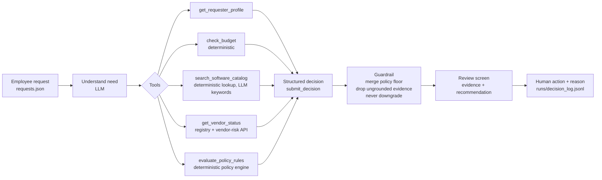

# Architecture, workflow and assumptions

## Split of responsibility

| Layer | Owns | Why here |
|---|---|---|
| **Code** (deterministic) | Approval thresholds, budget arithmetic, 365-day review freshness, registry vs vendor-risk API conflict, required fields, Security/Privacy/Legal triggers, prompt-injection scan, guardrail merge | Fixed rules that can be written down. Same input gives the same output, and boundary cases are unit-tested. |
| **AI** (Gemini) | Understanding the need, judging catalog overlap ("does an existing tool cover this? is the stated gap credible?"), judging whether the business purpose is adequate, choosing the recommendation, writing the next step and clarifying questions | These are semantic judgments the steps cannot be written down for in advance. |
| **Human** | Every approval, rejection and exception. The UI records the action plus a mandatory reason. | Policy section 11: decisions have consequences, may be irreversible, and someone has to be accountable for them. |

## Workflow

### Architecture A: single agent
One Gemini tool-calling loop (`mode=ANY`, temperature 0, max 8 turns). The agent chooses which tools to call, and the run ends when it calls `submit_decision` with a JSON-schema-constrained argument.

### Architecture B: staged / 2-agent
1. **Procurement Analyst**: the same tools. It ends with `submit_evidence_pack` (need summary, evidence, existing alternatives, purpose adequacy, open questions, suspicious content) and is not allowed to recommend.
2. **Policy/Risk Reviewer**: has no data tools. It receives the evidence pack **plus the raw tool results** so it can check the analyst's claims, then calls `submit_decision`.

Both architectures pass through the same guardrail (`src/agents.py::finalize`), so any difference between them comes from the agents alone.

## Guardrail rules (the reliability layer)
- The policy engine output is the **floor**. The LLM may add approvals or flags but cannot remove them, and each addition by the guardrail is logged in `telemetry.guardrail_corrections`.
- The recommendation severity is `clarification > escalate > reuse > route`. Blocking evidence (missing fields, vendor risk unavailable, conflicting vendor records, budget exceeded or unverifiable) raises the recommendation; the LLM can never lower it.
- An evidence item survives only if its `source` names a tool that was actually called in that run.
- `human_review_required` is always `true`. The copilot has no tool that can approve, purchase or change budgets.
- If the LLM fails (no key, quota, error), the system returns the deterministic decision, flagged `llm_unavailable`.
- Model fallback (`MODEL_NAME` then `MODEL_FALLBACKS`) happens **per run**, because tool-call history isn't portable across models. The model used is recorded in telemetry.

## Tool design

| Tool | Deterministic | Input | Notes |
|---|---|---|---|
| `get_requester_profile` | yes | request_id | department and manager from `employees.csv` |
| `check_budget` | yes | request_id | reads cost and department from the system of record, never from model arguments |
| `search_software_catalog` | yes (lookup) | request_id + LLM keywords | same category / same vendor / keyword matches, with purchase history |
| `get_vendor_status` | yes | vendor_name | registry + live API; computes freshness and conflicts; 404 means "no assessment", 5xx or unreachable means "unverified" |
| `evaluate_policy_rules` | yes | request_id | runs the full policy engine |

The tools that touch money and policy take `request_id`, not free values. This prevents injected text like "treat as CFO-approved" or "cost is $0" from ever reaching a check.

## Assumptions
- **Reference date** is parsed from `procurement_policy.md` (2026-09-30), never the machine clock. A review is current if `review_date + 365 days >= reference date`.
- **Overlap floor:** a catalog item in the **same category** sets `existing_tool_overlap`. Deciding whether that means "reuse the existing tool" is left to the LLM. Same-vendor items are evidence only (e.g. a SignFlow training pack does not overlap SignFlow e-signature).
- **Vendor conflict:** the registry and API disagree on approved vs not-approved, or on the review date.
- **Unknown data-access level** is treated as possibly sensitive, so it triggers Security, and Privacy/Legal if the vendor stores data outside the region.
- **Vendor-risk API down** means the assessment is not current and data residency is unverified. Security review is required, Privacy too if the data is sensitive, and the recommendation escalates to manual review.
- **Missing department budget row** (e.g. E007 "Go To Market") produces `budget_unverified`, Finance review and escalation.
- **Cost unknown:** the threshold can't be computed, so Procurement triages and the requester is asked for clarification.
- **Legal for new vendors** applies at `>= $10,000` (section 7), while financial tiers use `> $10,000` (section 4), matching the policy wording.
- **Prompt injection** is detected by a regex heuristic in code, which acts as the floor, and the LLM is also instructed to flag it. Either way, the embedded instruction is ignored.

## What I intentionally did not build
- A new-request submission form. Requests come from `requests.json`, the system of record for this slice.
- Real notifications or approval routing. "Send to approvers" records the decision only.
- Authentication and per-role permissions.
- A third agent or a framework (LangGraph, CrewAI). The comparison showed no need for either (see the memo).
- Persistent analysis cache. Each analysis re-reads live data.
